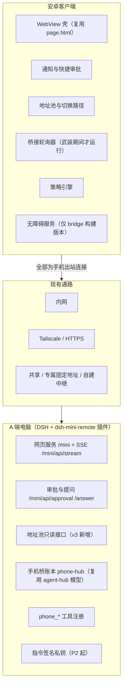
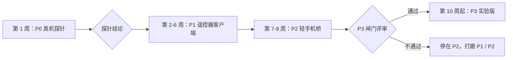

# dsh-mini-remote 安卓客户端与手机桥 RFC（第三版）

- **状态**：草案 v3（基于 2026-11-03 的 v2，并入 2026-11-04 的审定意见）
- **日期**：2026-11-04
- **关联**：插件 0.2.7；`lib/page.html`、`lib/server.js`、`lib/pairing.js`、`lib/agent-hub.js`、`lib/agent-client.js`、`lib/devices.js`、`lib/notify.js`；共享 / 专属固定地址
- **读者**：产品决策者、实现者
- **标注约定**：每个关键决策标置信度（高 / 中 / 低）；标 **【待真机验证】** 的条目，在 P0 探针拿到结果之前不得当成事实写进实现
- **和 v2 的关系**：v2 的阶段划分、构建版本隔离、长轮询复用、审批双状态、硬拒规则、签名机制全部保留。v3 只做三类改动：修掉一处事实、统一一处数字、把四条“看起来严但不可靠”的规则改成可执行的形态，并把 v2 留在第 14 节的五个问题直接拍板。

---

## 0. 结论先行

三个可以独立停下来的阶段：

| 阶段 | 交付物 | 需要无障碍权限吗 | 面向谁 | 单独有没有价值 |
|---|---|---|---|---|
| **P1 遥控器客户端** | 原生壳 + 锁屏也能收到的审批/完成通知 + 通知里直接批准 + 系统分享到 DSH | **不需要** | 所有现有手机用户 | 有。补上网页锁屏后断连这块硬伤 |
| **P2 轻手机桥** | 电脑把东西**送到**手机：通知、链接、文件、剪贴板 | **不需要** | 所有人 | 有。覆盖“电脑 → 手机”八成真实诉求 |
| **P3 手机操控（实验）** | 电脑看屏幕、点按、输入 | **需要**，单独的构建版本 | 明确选择加入的进阶用户 | 有，但前提是 P0 探针与 P3 闸门都通过 |

v3 相对 v2 的六处实质改动：

1. **配对二维码是“一址一码”**，不是“一个码带多条地址”。客户端扫任意一枚之后，必须调插件的地址池接口拿全路径（接口见第 11 节）。
2. **配额数字先别写死**：现有材料里“每天 5 万”和“每天 10 万”两说，v3 标记为待核实，武装制的上限按比例而不是按绝对台数写。
3. **共享固定地址上的手机桥改为“提示 + 硬上限”**：每台设备每天武装总时长不超过 2 小时，超出即提示改走 Tailscale 或专属地址。
4. **“用户亲手触摸就作废”降级为辅助信号**：默认只把“注入动作后 1 秒内的触摸”当异常，另加 5 分钟无操作自动收回，避免 ROM 误判导致授权频繁丢失。
5. **B 端不纳入武装制**：B 端是“配对一次长期在线”的既有产品体验，保持现状，只加监控。
6. **第 14 节的五个问题已拍板**（见第 14 节），不再留给决策者。

---

## 1. 这份 RFC 依赖的项目事实

| 事实 | 出处 | 对本 RFC 的影响 |
|---|---|---|
| A/B 协作用 **HTTP 长轮询**：B 出站连 A，单次轮询最长 25 秒，任务默认 30 秒超时，90 秒没轮询算离线，配对码一次性、10 分钟有效 | `lib/agent-hub.js` | 手机桥直接复用这套模型，不新造协议 |
| 设备凭据是 `id.密钥`（各 128 位），服务端只存 SHA-256；可用 cookie `dsh_mini_device` 或请求头 `X-Mini-Device` | `lib/devices.js` | 原生层直接用请求头 |
| 设备名册**最多 5 台**，30 天没活动自动删除 | `lib/devices.js` | 同一部手机的浏览器和 App 各占一格 |
| 审批/提问归属：手机 SSE 连着，**或** 20 秒内露过面，就算“手机在”；全断开就还给电脑 | `lib/server.js` | 客户端后台保活会改变这个语义（见 5.2） |
| 审批接口 `POST /mini/api/approval {id, decision}`，已结束的审批返回 409 | `lib/server.js` | 通知按钮可直接调，不必拉起 WebView |
| 已有外部推送：Bark、ntfy、Telegram，标题固定“DSH 任务完成” | `lib/notify.js` | 可作唤醒通道（见 5.3） |
| 网页的 Service Worker 只发系统通知，且要求 HTTPS | `lib/sw.js` | 明文内网下网页拿不到通知，这正是客户端的价值 |
| A/B 的信任假设是“A 是用户自己的电脑，防误操作，不防恶意” | `lib/agent-client.js` | **C 端不能照搬**：A 上的模型会读到不可信内容 |
| 共享固定地址的每个代理请求都消耗 Worker 与 KV 配额；**免费额度具体数值待核实**（现有材料 5 万/日与 10 万/日两说） | `docs/A-承载量估算.md`、运维后台 | 长轮询常驻会吃共享配额（见 6.5） |
| 配对面板是**一址一码**：内网、Tailscale、隧道各生成一个二维码，码里只有单个地址 + 令牌 | `lib/pairing.js` | 客户端不能假设码里有全部路径，需地址池接口（见 5.4） |
| 目前**没有**对外的“地址池”只读接口；设置页是在进程内直接调 `buildPairing` | `lib/pairing.js`、`lib/server.js` | P1 需要新增一个只读接口（见 11） |

---

## 2. 需求重新界定

### 2.1 保留的真实需求（置信度：高）

| 编号 | 需求 | 依据 |
|---|---|---|
| R1 | 手机锁屏、切到别的 App 后，仍能收到“待审批 / 被提问 / 任务完成”提醒 | `server.js` 注释里反复记录的真机问题；Service Worker 通知只在 HTTPS 下可用 |
| R2 | 不打开页面，直接在通知里批准或拒绝 | 审批接口已存在 |
| R3 | 从别的 App 把文字或图片分享给 DSH | 现有上传/发送接口能接住 |
| R4 | 电脑把结果**送到**手机：链接、文件、一段要粘贴的文本 | “电脑 → 手机”最常见的真实诉求 |
| R5 | 出门换网络后自动重连，不用重新扫码 | 现有连接方式本来就有多条路径 |

### 2.2 降级为实验的需求（置信度：中）

| 编号 | 需求 | 降级理由 |
|---|---|---|
| X1 | 电脑操控手机 UI | 场景矛盾：人在电脑前不需要；人在外面时电脑抢手机屏幕会打断他。真实受众主要是真机验收与单 App 自动化，与“非技术用户友好”的定位不重合 |

### 2.3 删除或推迟（置信度：高）

| 项目 | 处理 | 理由 |
|---|---|---|
| 读手机通知 | **删除** | 会读到验证码与私聊，同时是提示注入的直接入口 |
| 敏感 App 内“每次确认后可操作” | **删除，改为硬拒** | 设置页/权限页一旦能点，模型可给自己开权限；支付点错是真金白银 |
| 局域网自动发现（mDNS） | 删除 | 发现了地址也拿不到凭据，最终仍要扫码 |
| 桌面小组件 | 推迟到 P3 之后 | 与常驻通知重复；国产 ROM 刷新不可靠 |
| 指纹解锁 | 推迟到 P1 收尾，作为可选应用锁 | 不改服务端鉴权，优先级低 |
| `MediaProjection` 截图兜底 | 删除 | Android 14 起每次捕获都要重新授权；P3 最低版本 Android 11，可直接用无障碍截图 |
| Shizuku | 不做 | 重启后要重新激活，与非技术用户定位冲突 |

### 2.4 v2 补上、v3 保留的需求

| 编号 | 需求 | 落在哪一节 |
|---|---|---|
| N1 | 地址池与自动切换路径（客户端扫一码后取全量） | 5.4 |
| N2 | 锁屏/息屏时立刻报错，不在锁屏界面瞎点 | 7.4 |
| N3 | 用户亲手操作时让出控制权（v3 改为辅助信号 + 超时收回） | 8.4 |
| N4 | 客户端与插件的协议版本协商与升级提示 | 6.2 |
| N5 | 双端审计（手机存全文，电脑存脱敏回执） | 8.6 |
| N6 | 审批归属语义适配原生客户端 | 5.2 |

---

## 3. 设计原则

1. **灵魂在电脑**：推理、上下文、编排都留在 A。不在手机上跑 DSH、Linux 或模型。
2. **手机是最终裁判，裁判本身也要防篡改**：确认环节不能被本 App 的无障碍能力点掉，也不能被中继伪造的指令触发。
3. **能“送达”就不“操控”**：能通过 Intent、通知、文件或剪贴板完成，就不走 GUI 自动化。
4. **权限按构建版本隔离**：标准版永远不声明高危权限。
5. **网页是唯一的 UI 实现**：原生层只做网页做不到的事。
6. **不承诺 24 小时保活**：只在有任务或桥接开启时保活。
7. **共享中继配额是公共资源**：任何常驻轮询都要算账。
8. **不可靠的信号不当硬规则**（v3 新增）：ROM 上验证不了的能力，只能当辅助判断，并配一个确定性的兜底。

---

## 4. 总体架构



连接方向不变：**全部由手机出站**。网页内容走 HTTP + SSE；手机桥走 HTTP 长轮询；不新增 WebSocket 端点。

---

## 5. P1：遥控器客户端

### 5.1 形态（置信度：高）

WebView 承载现有页面，Kotlin 原生层只做五件事：

| 原生职责 | 实现要点 |
|---|---|
| 扫码配对 | CameraX 识别配对 URL → 原生层完成设备登记，拿到 `id.密钥` → 存进 Keystore 加密存储 → 写入 WebView 的 CookieManager（`dsh_mini_device`） |
| 地址池 | 扫到任意一条地址后，调地址池接口拿全部路径；按“内网 → Tailscale HTTPS → 固定地址”探测 `/mini/api/version`，失败换下一条，切换时重新加载 WebView |
| 通知 | 见 5.3 |
| 快捷审批 | 通知按钮直接 `POST /mini/api/approval`，请求头带 `X-Mini-Device`；409 时把通知改成“已在别处处理” |
| 系统分享 | 接 `ACTION_SEND` / `ACTION_SEND_MULTIPLE` → 走 `/mini/api/upload` 与 `/mini/api/send` |

**原生层不另起一条长连接去同步页面状态**：前台时只有 WebView 自己连 SSE；后台时由通知通道负责（5.3）。

### 5.2 审批归属语义（置信度：高，**已拍板**）

**问题**：`hasPhone()` 的判据是“SSE 连着，或 20 秒内露过面”。客户端后台保住连接后，手机永远“在”，审批不会还给电脑，人锁屏放兜里时电脑会一直卡着。

**方案**：客户端上报两个独立状态，服务端分开判断：

- `attention = foreground`：用户正在看，行为与现在的网页完全一样。
- `attention = reachable`：在后台，但能收到通知。

`hasPhone()` 规则：

- `foreground` → 算在场。
- `reachable` → 由新设置项「审批优先发到手机」决定。**默认关**；打开时手机上最多等 **120 秒**，超时还给电脑。

改动范围：`lib/server.js` 的 `hasPhone()` / `notePhoneSeen()`，`/mini/api/presence` 增加字段。网页版行为不变。

### 5.3 后台唤醒通道（置信度：中，【待真机验证】）

不做 24 小时保活，按场景分三层：

| 场景 | 唤醒方式 | 说明 |
|---|---|---|
| 有任务在跑或有待审批 | 任务期间开启的前台服务（`dataSync`，Android 14 起必须声明类型），保持一条 SSE | 任务结束后 60 秒内自动停止 |
| 空闲时 | 复用 `lib/notify.js` 的 **ntfy** 渠道；**优先建议用户自建 ntfy 实例** | 公网 `ntfy.sh` 在国内可达性不稳，且内容对服务方可见 |
| 以上都没有 | 只在打开 App 时同步 | 明确告诉用户“空闲时不会主动提醒” |

**插件配合**：`notify.js` 的推送按事件类型区分（待审批 / 被提问 / 完成），正文去敏、带会话 id；**正文不能带审批详情**，只发“有一条待审批”，用户点开后客户端再去 A 拉详情。

**【待真机验证】**：ntfy / UnifiedPush 在小米、vivo、OPPO 后台的存活率与延迟分布，P0-b 实测。

### 5.4 地址池（v3 修正）

配对面板是**一址一码**：内网、Tailscale、隧道各一枚，码里只有单个地址与令牌。因此客户端流程是：

1. 扫任意一枚码，完成设备登记；
2. 立刻调 `GET /mini/api/addresses`（v3 新增，见第 11 节）拿这台电脑的完整地址池；
3. 按池顺序探测 `/mini/api/version`，选第一条通的作为当前地址；
4. 之后网络变化时按同一池重新探测。

地址池接口只返回地址与类型标签，**不返回令牌**（令牌已在设备凭据里）。

### 5.5 设备名册占位

同一部手机上浏览器和 App 各占一个名额（上限 5 台）。登记时 `kind` 记 `android-app`，设置页显示“某某手机（App）”。不与浏览器身份合并（`devices.js` 的原则是“不用指纹认人”）。

### 5.6 P1 验收（真机，不接受模拟器）

一台未开开发者模式的量产小米（澎湃 OS）+ 一台 vivo 或 OPPO：

1. 从浏览器下载 APK 安装，记录系统拦截次数与位置；标准版要求 **0 次“高危权限”警告**。
2. 扫码连上 A，三档视图可切换。
3. 切到 5G、离开家里 Wi-Fi：WebView 10 秒内自动切到 Tailscale 或固定地址，不需重新扫码。
4. A 发起需要审批的任务后锁屏：前台服务存活，手机 **5 秒内**亮屏弹通知；点“批准”后 A 继续；同一条审批已在电脑处理时，通知显示“已在别处处理”。
5. 从相册分享一张图给 DSH：A 当前会话收到图片并能回答内容。
6. 「审批优先发到手机」关闭时：锁屏 20 秒后审批按现有逻辑还给电脑（回归，行为不能变）。

---

## 6. 手机桥通用层（P2 与 P3 共用）

### 6.1 传输：复用长轮询（置信度：高）

新增 `phone-hub`，复制 `agent-hub` 的模型：

- 配对：A 生成 6 位配对码（10 分钟有效），手机提交后换长期凭据；服务端只存哈希。
- 取任务：手机 `POST /mini-remote/phone/poll` 长轮询，单次最长 25 秒。
- 回结果：`POST /mini-remote/phone/result`，带 `taskId`；只认发起任务的那台手机。
- 大块数据：`POST /mini-remote/phone/blob/<taskId>`，二进制请求体。

不用 WSS：现有四种通路都已验证能跑长轮询；Worker 中继的 WebSocket 验收在运维手册里仍标“未完成”。

### 6.2 消息格式（置信度：中）

JSON-RPC 2.0，方法名复用 MCP 的 `tools/list`、`tools/call`、`notifications/cancelled`，schema 用 `inputSchema`。**不实现完整 MCP 握手**，只复用语义。

握手时手机上报：

```json
{"bridgeProtocol":1,"appVersion":"0.1.0","flavor":"standard","sdk":34,"tools":["phone_notify","phone_open_url"]}
```

插件按 `bridgeProtocol` 判断兼容性：不兼容就拒绝，并提示“请升级客户端”。不用版本号字符串比较。

### 6.3 工具命名（置信度：中）

用 `phone_*`，不用 `c_*`。`c_` 对模型没有语义，同时看到 `b_read`、`c_tap` 更容易选错。内部文档可继续叫“C 端”。

### 6.4 工具可见性

只有“桥在线”且“用户在手机上武装了桥接”同时满足，`phone_*` 才注册给模型；其他时间模型看不到，不浪费上下文。

### 6.5 武装与配额（置信度：高，**数值待核实**）

**账**：一台手机每 25 秒轮询一次，一天约 3456 个请求。共享固定地址的免费额度若是每天 10 万次，不到 30 台常驻就直接吃光；若是 5 万次，则不到 15 台。

因此不按“台数”写死规则，按比例与时长控制：

- 桥接默认**不轮询**。用户在手机上点“允许电脑使用手机（30 分钟）”后才开始；到期或任务结束空闲 10 分钟后自动停止。
- **走共享固定地址时**：设置页明确提示“会占用共享额度”，并建议改走 Tailscale 或专属固定地址；
- **硬上限（v3 新增）**：走共享地址时，**每台设备每天武装总时长 ≤ 2 小时**；超出后当天只允许 Tailscale / 专属地址，界面写明原因。
- **配额数值待核实**：把免费版真实额度（5 万还是 10 万、按什么口径计）在运维台核实一次，写进文档后再调整上限；在此之前，任何“多少台会打满”的说法都只能当估算。
- **A 端改动**：运维台加“长轮询请求占比”一项，用于观察。

---

## 7. P2：轻手机桥（不需要无障碍）

### 7.1 安卓限制（置信度：高）

- Android 10 起，App 在后台**不能主动打开界面**；“打开链接”只能发通知由用户点击。
- Android 10 起，后台**不能读剪贴板**；写入可以，Android 13 起系统提示“已复制”。
- 文件写到“下载”目录用 MediaStore，不需要存储权限。

### 7.2 工具集

| 工具 | 作用 | 用户需要做什么 |
|---|---|---|
| `phone_notify(title, body, url?)` | 发通知；带 url 时点通知打开链接 | 看一眼或点一下 |
| `phone_send_file(name, blobRef)` | 存到“下载/DSH”，并发通知 | 点通知打开 |
| `phone_set_clipboard(text)` | 写剪贴板并发通知“已复制” | 粘贴 |
| `phone_status()` | 电量、网络类型、是否锁屏、前台是否本 App | 不需要 |

明确**不提供**：读剪贴板、读短信、读通知、读相册。要拿手机数据，一律由用户主动通过系统分享发给 DSH。

### 7.3 安全级别

P2 工具只“送达”，最坏后果是骚扰与剪贴板被覆盖。授权规则：武装期间可直接调用；每次调用写手机本地审计。`phone_set_clipboard` 连续调用超过 5 次弹窗询问。

### 7.4 P2 验收

1. A 上说“把刚才那份报告发到我手机”：手机“下载/DSH”出现文件并收到通知。
2. A 上说“把这段地址复制到我手机”：提示已复制，粘贴到微信内容正确。
3. 手机未武装时：模型工具列表里没有 `phone_*`。
4. 走共享地址武装 30 分钟：Worker 请求增量约 80 次，到期归零。

---

## 8. P3：手机操控（实验，独立构建版本）

### 8.1 进入条件（闸门，**已拍板**）

三条全部满足才开工：

1. P0 探针证明：澎湃 OS 与 OriginOS 上，侧载的 `bridge` 版能完成“允许受限设置 → 开启无障碍 → 截图 → 点击”，且步骤数可写成图文引导。
2. P1 已发布且有 **≥10 个真实用户**使用（v3 从 20 下调）。
3. 至少 **3 个真实用户**明确提出了操控类场景（不是我们想象的）。

### 8.2 构建版本（置信度：中）

同一份代码出 `bridge` 版本：`applicationId` 与签名和标准版相同，可直接覆盖升级、数据保留；只有 `bridge` 版清单声明 `AccessibilityService`。**【待真机验证】**：国产 ROM 是在安装阶段按清单报警，还是开启无障碍时拦截。

最低 **Android 11（API 30）**（需要无障碍截图 `takeScreenshot`）；该接口有调用频率限制，工具实现要节流。

### 8.3 工具集（6 个）

| 工具 | 说明 |
|---|---|
| `phone_observe(withImage?)` | 一次调用返回：前台包名、窗口 id、是否锁屏、可交互控件列表（序号、文字、描述、边界框）、`stateToken`；可选附一张本地画好序号框的截图，图片走二进制通道 |
| `phone_open(package)` | 只能打开授权范围内的 App |
| `phone_tap(index 或 {x,y}, stateToken)` | 先点控件；控件失败退回点边界框中心 |
| `phone_input(text, index?, submit?, stateToken)` | 点输入框 → 等焦点 → 填文本 → 可选回车 |
| `phone_swipe(direction, stateToken)` | 上/下/左/右，不让模型算像素 |
| `phone_back()` | 返回键；不提供主页与最近任务 |

所有动作执行完、界面稳定（约 500 毫秒）后自动附带精简 `phone_observe`，把“做一步”与“看一眼”合并成一次往返。

### 8.4 授权模型（置信度：高；**触摸检测改为辅助信号**）

一次任务授权由手机弹窗确认，弹窗内容全部由手机本地生成，**不显示任何模型可编辑的文字**：

- 哪台电脑（显示名册里的名字）
- 允许操作哪些 App（A 申请包名，手机显示图标与名称）
- 有效时长（默认 10 分钟，最长 30 分钟）

授权期间，以下情况**立即作废**，需重新申请：

- 前台 App 离开授权范围（含回到桌面）
- 屏幕锁定或熄灭（返回错误 `screen_locked`）
- 用户点了通知栏的“停止”
- **5 分钟无任何注入动作**（v3 新增的确定性兜底）
- 检测到“注入动作后 1 秒内”的触摸（v3 调整：只在这个窗口内算异常）

**为什么这么改**：区分“真人触摸”与“注入手势”在国产 ROM 上并不可靠（v2 自己也标了待验证）。把它当硬规则，一次误判就会让正常滑动丢掉授权，体验很差；降级成辅助信号，再用“无操作自动收回”这个确定性的规则兜底，安全与可用性都保得住。

### 8.5 硬拒规则（永不执行，也不弹窗）

以下一律拒绝，只写审计：

- **包名命中**：银行、支付、证券、密码管理器、`com.android.settings`、权限控制器、各家手机管家、安装器、本 App。
- **窗口特征命中**：当前窗口有安全标记（`FLAG_SECURE`），或焦点控件是密码框。
- **文字特征命中**：界面出现“支付密码 / 确认付款 / 免密支付 / 转账”等字样。
- **社交发送动作**：微信、QQ、短信、飞书、钉钉里，点“发送”一律拒绝；只能填草稿。

### 8.6 防篡改机制（置信度：高）

| 攻击 | 机制 |
|---|---|
| 本 App 无障碍点掉自己的确认弹窗 | 有确认弹窗等待时，策略引擎**关闭所有注入通道**，A 的动作直接丢弃；确认用系统 `BiometricPrompt`，无障碍无法代按 |
| 中继或中间人伪造指令 | 二维码带 A 的 P-256 公钥指纹；A 对每条 `tools/call` 签名（含 `bridgeId`、单调序号、时间戳、参数摘要）；验签失败、序号回退、时间偏差超 60 秒都拒绝。P2 工具同样签名 |
| 指令在路上时界面已变 | 动作带 `stateToken`（前台包名 + 窗口 id + 顶层标题摘要），执行前重算，对不上返回 `409 state_changed` |
| 间接提示注入 | 授权限定 App 范围 + 离开即作废 + 社交 App 禁止点发送 |
| 配对劫持 | 配对码一次性、10 分钟有效；配对成功后两端同时提示“新增了一台手机”；A 的设备列表可随时撤销 |
| 恶意 App 冒充客户端 | 凭据与签名密钥在 Keystore；紧急停止在通知栏（系统界面无法伪造）；只从 GitHub Release 分发并公布证书指纹 |

审计：手机本地保存完整记录 7 天（工具名、参数摘要、结果、拒绝原因）；A 端只存脱敏回执（时间、工具名、结果码、拒绝类别），显示在会话轨迹里。截图与输入文字不回传审计。

### 8.7 性能预期（置信度：中）

一步约：截图与控件树 0.3 秒 + 中继上传 0.2～0.6 秒 + 模型推理 1.5～4 秒 + 界面稳定 0.5 秒，**合计 2.5～5.5 秒**。定位：单个 App 内、8 步以内的确定性操作；不承诺长列表搜索与跨 App 串联。

### 8.8 P3 验收

1. A 上说“在备忘录里新建一条‘周三交方案’”：手机弹授权（指纹）→ 完成 → 截图回传，总耗时 < 30 秒。
2. 授权范围是备忘录时，`phone_open("com.tencent.mm")` 被拒绝，审计有记录。
3. 任务中手动切到微信：授权立即作废，A 收到 `scope_left`。
4. 备忘录里写着“打开设置”的界面：模型照做也会被硬拒规则拦下。
5. 伪造签名的 `phone_tap`：被拒绝。
6. 锁屏时调用：返回 `screen_locked`，屏幕不亮。

---

## 9. P0：真机探针（第一周最先做）

两个一次性 Demo，不进主代码库：

| 探针 | 要回答的问题 | 产出 |
|---|---|---|
| **P0-a 安装与权限** | 侧载的标准版 / bridge 版在澎湃 OS、OriginOS、ColorOS 上各被拦截几次？开启无障碍要几步？过夜会不会被系统关掉？ | 每台机器一份截图步骤记录 |
| **P0-b 后台唤醒** | 任务期间前台服务 + SSE 走固定地址，锁屏 10 分钟后还活着吗？ntfy / UnifiedPush 空闲唤醒的延迟分布？ | 每台机器的存活时间、延迟统计 |

**决策规则**：

- P0-a 显示开启无障碍要超过 8 步，或过夜被系统关掉 → P3 搁置。
- P0-b 显示任务期间都保不住连接 → P1 通知完全退回 ntfy，并调低承诺。

---

## 10. 平台与分发

| 项目 | 决定 | 置信度 |
|---|---|---|
| iOS / HarmonyOS NEXT | 不做客户端；继续用网页 + Bark / 飞书 | 高 |
| 分发 | GitHub Release（公布证书指纹）+ 酷安；不上主流应用商店 | 高 |
| 标准版定位 | 普通用户工具，图文引导 ≤3 步 | 高 |
| bridge 版定位 | “进阶 / 实验”，只在 GitHub 发布，安装页写清风险 | 中 |
| 版本号 | 客户端独立，从 0.1.0 起；兼容性靠 `bridgeProtocol` | 高 |
| 应用内升级提示 | 启动时查 GitHub Release；协议不兼容强制提示 | 中 |

---

## 11. 插件侧改动清单

| 改动 | 文件 | 阶段 |
|---|---|---|
| **地址池只读接口 `GET /mini/api/addresses`**（只返回地址与类型，不含令牌） | `lib/server.js`、`lib/pairing.js` | **P1（v3 新增）** |
| `presence` 增加 `attention` 字段；`hasPhone()` 区分前台与可达；新增设置项「审批优先发到手机」（默认关，等待 120 秒） | `lib/server.js`、设置页 | P1 |
| ntfy 推送按事件类型区分，正文去敏，带会话 id；提示可自建 ntfy | `lib/notify.js` | P1 |
| 设备登记支持 `kind: android-app` | `lib/devices.js` | P1 |
| `phone-hub`：配对、长轮询、结果、二进制上传、武装状态 | 新文件，复制 `agent-hub.js` 模型 | P2 |
| `phone_*` 工具注册，只在在线且已武装时可见 | 新文件，参照 `agent-tools.js` | P2 |
| 指令签名（P-256，`node:crypto`） | 新文件 | P2 |
| 运维台显示长轮询请求占比，并核实免费额度口径 | `worker/src/index.js`、`dashboard.js` | P2 |

---

## 12. 时间线（按三个月）



---

## 13. 风险

| 风险 | 概率 | 对策 |
|---|---|---|
| 国产 ROM 后台杀连接，通知迟到或丢失 | 高 | 只承诺任务期间保活；空闲走 ntfy；设置页如实写“空闲时提醒可能延迟” |
| 团队被 ROM 兼容问题拖住，主插件停摆 | 高 | 只适配 P0 那 3 台机器；不写单一 ROM 的保活技巧；每周给客户端设工时上限 |
| 原生客户端改变审批归属，电脑一直卡住 | 中 | 双状态方案默认关，网页行为不变，纳入回归测试 |
| 手机桥长轮询耗尽共享中继配额 | 中 | 武装制 + 共享地址每日 2 小时硬上限 + 运维台监控 |
| **配额数字误判导致上限设错**（v3 新增） | 中 | 先核实免费额度真实数值，再调上限；在此之前按比例而非台数描述 |
| **触摸/注入误判导致授权频繁丢失**（v3 新增） | 中 | 触摸只当辅助信号；用“5 分钟无操作收回”做确定性兜底 |
| P3 演示好、实际不行 | 高 | 闸门要求真实场景；对外定位“实验”，承诺限定单 App 8 步内 |

---

## 14. 已拍板的问题（2026-11-04）

v2 留了五个待决问题，v3 直接给出结论：

| # | 问题 | 结论 | 理由 |
|---|---|---|---|
| 1 | 「审批优先发到手机」默认值 | **默认关；打开后手机等待 120 秒** | 保持网页行为不变是最好的兼容；120 秒够人看见并处理，又不至于让电脑干等 |
| 2 | P3 闸门的用户数 N | **10（原 20 下调），3 个真实场景保留** | 门槛要卡“有没有真需求”，不是凑人数；10 个真实用户足以暴露基础问题 |
| 3 | 社交 App 禁止点“发送” | **接受，只能写草稿** | 代点发送一旦出错，损失的是用户在朋友/同事那里的信誉，比省一步点击值钱 |
| 4 | 共享固定地址是否禁止手机桥 | **不禁止；提示 + 每日 2 小时硬上限** | 一刀切会挡住没有 Tailscale 的用户；限时既保住公共配额，也留了可用性 |
| 5 | B 端长轮询是否纳入武装制 | **不纳入，只加监控** | B 端是“配对一次长期在线”的既有体验，改它等于改产品；手机桥是新东西，可以要求 |

仍然需要真机才能定的事（不在本节拍板）：P0-a 的权限步骤数与过夜存活、P0-b 的唤醒延迟、触摸与注入的可区分性、`FLAG_SECURE` 可读性。

---

## 变更记录

| 日期 | 变更 |
|---|---|
| 2026-11-03 | 初稿 |
| 2026-11-03 | v2：拆成 P0–P3；无障碍移入独立构建版本；手机桥复用长轮询；新增审批双状态、武装制与配额核算、App 范围授权、指令签名、`stateToken`；删除读通知、L2、mDNS、MediaProjection |
| 2026-11-04 | v3（本文件）：修正“一址一码”事实并新增地址池接口；配额数字标为待核实、改为比例描述；共享地址加每日 2 小时硬上限；触摸检测降级为辅助信号 + 5 分钟无操作收回；B 端不纳入武装制；第 14 节五个问题拍板（默认关/120 秒、N=10、接受禁发、不禁止但限时、B 端只监控）；新增两条风险 |
