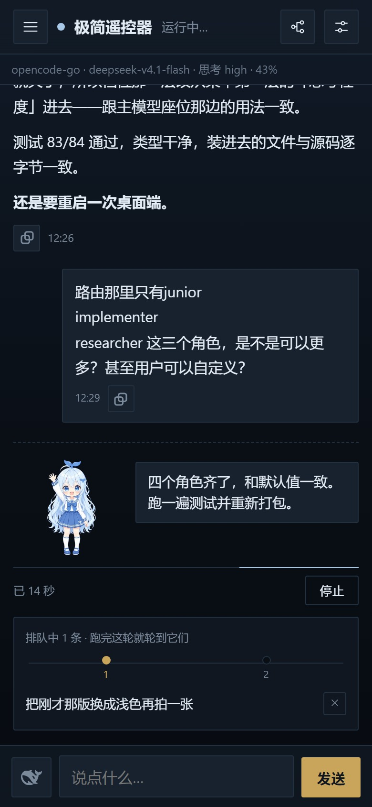
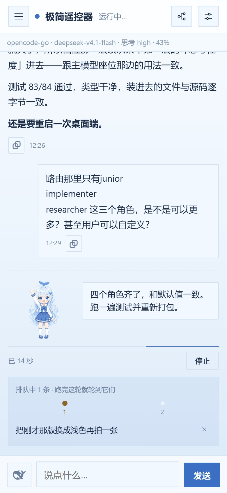

# 手机连接与密码

这一块在「设置 → 遥控设置」最上面，始终展开。

## 连接

- 每条地址旁边有二维码；手机扫码即可。
- 地址框点一下会全选，方便复制。
- 地址里带入场口令，不要截图外发。

## 密码

- 密码默认打码，点「显示」才看见。
- 「复制密码」用于给另一台电脑配对，不要发给陌生人。
- 改密码后要重启 DSH 才生效，之后手机要重新扫码。

## 运行中的页面

运行中会显示当前耗时、排队数量和停止按钮；深色与浅色主题的布局一致。

  
  

## 做完应该看到

- 手机能打开会话列表；
- 「电脑与设备」里出现这台手机。

## 注意

本页包含连接密码，不要投屏、截图或转发。
