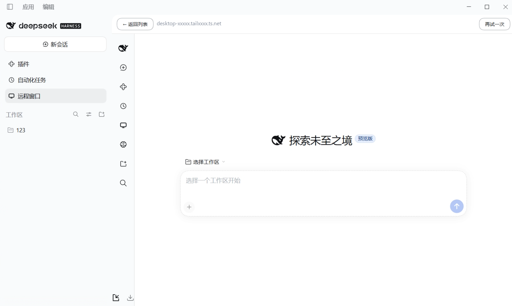

# 远程窗口

远程窗口在 DSH 左侧栏，不在设置页分组里；它让 B 的 DSH 桌面端直接嵌入 A 的完整界面。

  

## A 端

1. 打开「设置 → 遥控设置 → 电脑与设备」；
2. 开启「允许别的电脑连接」；
3. 在「手机连接」复制访问口令，给 B 配对用。

## B 端

1. 打开「设置 → 遥控设置 → 电脑与设备 → 其他电脑」；
2. 点「添加一台电脑」；
3. 填 A 的地址和口令，起个名字；
4. 点「确认添加」；
5. 在名单里点 A，或从左侧栏「远程窗口」进入。

## 地址怎么填

- 填 A 的连接地址，不带 `/mini` 或后面参数；
- 跨机要用 `https://`；
- 推荐用 A 的 Tailscale HTTPS 地址；
- 临时公网地址每次重启会变，不适合长期用。

## 做完应该看到

- 面板里出现 A 的完整 DSH 界面，不是空白或一直 `Loading plugins…`；
- 顶部横条能返回名单或重试。

## 收回权限

在 A 的「电脑与设备 → 设备」里找到 B，点「撤销」并确认。B 已打开的窗口下一次请求会被拒绝。
